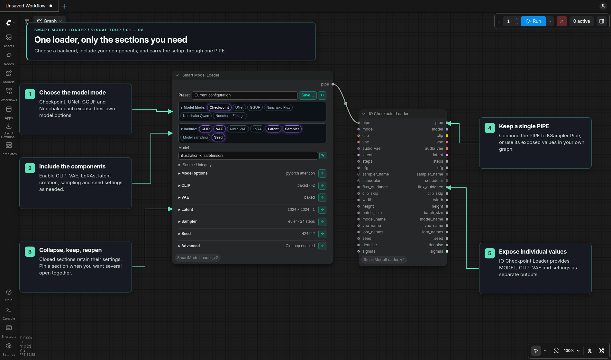

# ComfyUI Smart Model Loader v2

This independent repository provides a
pipe-based diffusion workflow with compact controls and collapsible
option bars in classic canvas and Nodes 2.0.
The design is adapted from DaSiWa, using dynamic controls to reduce widget and
layout overhead.

Choose **Settings → SML2 → Appearance → Node design** for Jade (default), Neutral,
Ocean, Amethyst, Amber or a custom JSON theme. Jade, Ocean, Amethyst and Amber
share a dark background with different control colors; Neutral keeps its lighter
gray background. The selection covers
shared panels and Download Manager, saves in `config.json` and loads on startup.
See [Node designs](Readme/Node_Design.md) for theme creation, reload and background precedence.

Find this pack's nodes under **🌒 Smart Model Loader v2** in ComfyUI's Add Node
menu, separate from the original **🌒 Smart Model Loader** category.

The main nodes are **Smart Model Loader [SML2]**, **CLIP Loader [SML2]**,
**LoRA Stack [SML2]**, **LoRA Stack Apply [SML2]**, and **KSampler Pipe [SML2]**.
Smart Model Loader can be configured for model-only loading.


[](https://github.com/comfyanonymous/ComfyUI)
[](https://linuxmint.com/)
[-76b900)](https://www.nvidia.com/)
[](LICENSE)

## Visual tours

The annotated screenshots use current Nodes 2.0 controls, with Jade callouts
in the Eclipse tour style. The same controls are available in classic canvas.

| Tour | What it shows |
| --- | --- |
| [Smart Model Loader](Readme/Smart_Loaders.md#visual-tour) | Model modes, local files, encoders, latent sizing, sampler/seed controls and presets |
| [Source / integrity → Download Manager](Readme/Download_Manager.md#visual-tour) | Start with only an AIR, choose and start a download, then receive the filename and verified hash automatically |
| [LoRA Stack](Readme/LoRA_Stack.md#visual-tour) | Compact rows, Apply wiring, Model/CLIP/Audio strengths and downloading into an AIR-only row |



## Loading and sampling

- [Smart Model Loader](Readme/Smart_Loaders.md) supports checkpoint, UNet, GGUF
  and Nunchaku models, with optional encoders, VAEs, LoRAs, latent creation,
  sampler settings, model sampling and seeds. Include selects the sections;
  collapsed sections retain their settings. IO Checkpoint Loader exposes values
  from its PIPE as direct outputs.
- [CLIP Loader](Readme/CLIP_Loader.md) has ordered dynamic encoder rows,
  architecture selection, local integrity and a comma-separated `clip_names`
  output. It has no presets or fixed row-count cap.
- [LoRA Stack and Apply](Readme/LoRA_Stack.md) provide up to 60 compact rows,
  Model / CLIP split / Audio (LTX) strengths, saved setups, and existing Nunchaku
  support. Empty slots are ignored.
- [KSampler Pipe](Readme/KSampler_Pipe.md) keeps sampler and seed controls
  visible with independent Use pipe settings, Tiled decode, Alpha and Preview buttons.
  Alpha defaults off for RGB output; enable it to preserve decoded transparency.
  MODEL/VAE come from the PIPE. The final decoded image replaces live previews
  when execution finishes.

## Presets and missing files

Smart Loader and LoRA presets apply only when selected. Their panels support
search, a remembered save name, overwrite and deletion. Workflows retain their
own settings. Smart Loader presets exclude Latent, Advanced settings and seeds.
Smart Loader presets use `templates/`; LoRA presets use `templates/lora-stack/`.
The pack includes 22 model presets. First setup copies missing presets into
`templates/` and records completion in `.eclipse_loader_data_migrated`. Existing
user presets are preserved. Later restarts and updates do not repeat extraction
or restore deleted presets. To add or restore a bundled preset manually, copy its
`.defaults/templates/NAME.json.example` file to `templates/NAME.json`.
Copy old Smart Loader template JSON files into `templates/` and select them to
import their settings. A reminder prompts you to save and explicitly overwrite
the file in the new format; loading alone preserves the original.

Missing filenames remain visible. **Source / integrity** stores CivitAI AIR or
Hugging Face references and expected hashes for each model, encoder, VAE or LoRA.
You can leave the filename and hash empty and enter only the AIR or HF repo ID.
Click **Open in Download Manager**, select the file, **Add Selected to Queue**,
then **Start Selected**. Verified completion fills the initiating field with the
actual filename, source and SHA-256. No preset is required, and closing the manager
does not prevent the return while the browser session remains open.

Selecting a local file also reads its existing source/hash sidecars. Other rows
and loaders keep their selections. Save or overwrite a preset explicitly when
you want to retain an updated setup. Loading a workflow or preset does not start
downloads. Follow the [Source / integrity tour](Readme/Download_Manager.md#visual-tour).

## Included nodes

| Group | Node | Purpose |
| --- | --- | --- |
| Loader | `Smart Model Loader [SML2]` | Model-only or complete PIPE configuration |
| Loader | `CLIP Loader [SML2]` | Ordered external encoders and filenames |
| Loader | `VAE Loader [SML2]` | External image/video VAE |
| Loader | `VAE Loader Video+Audio [SML2]` | Separate video and audio VAEs |
| Conditioning | `CLIP Text Encode [SML2]` | Scheduled conditioning |
| Conditioning | `CLIP Text Encode (Advanced) [SML2]` | Multipliers and Krea2 layer rebalancing |
| Conditioning | `Text Encode Qwen Image 2.1 [SML2]` | Qwen prompts and image references |
| Conditioning | `Text Encode MiniMax Music 3 [SML2]` | Caption/lyrics JSON and native Music 3 controls |
| Conditioning | `Conditioning Zero Out [SML2]` | Clear or truncate conditioning |
| Pipe | `IO Checkpoint Loader [SML2]` | Merge and expose PIPE values |
| Sampler | `KSampler Pipe [SML2]` | Sample, decode, preview and update PIPE |
| Sampler | `Qwen Image 2.1 Scheduler [SML2]` | Resolution-dependent SIGMAS |
| Tools | `LoRA Stack [SML2]` | Ordered LoRA setups and presets |
| Tools | `LoRA Stack Apply [SML2]` | Apply Model/CLIP or LTX strengths |
| Loader | `Nunchaku PuLID Loader [SML2]` | Load a Nunchaku Flux PuLID pipeline |
| Tools | `Nunchaku PuLID Apply [SML2]` | Apply PuLID identity guidance |

Every node in this pack uses a unique `[SML2]` ID, so both loader packs can be
installed together with separate menus. Existing workflow nodes with original-pack
IDs continue to belong to the original pack; add their `[SML2]` counterparts from
the v2 menu when switching a workflow. PuLID requires its compatible optional
dependencies. LTX text projections are supported through
Smart Model Loader's **External + Model File** CLIP source.

## Installation

From your ComfyUI installation:

```bash
cd custom_nodes
git clone https://github.com/r-vage/ComfyUI_SmartModelLoader_v2.git
cd ComfyUI_SmartModelLoader_v2
python -m pip install -r requirements.txt
```

Restart ComfyUI, then open **Add Node → Smart Model Loader v2**. Settings appear
under **SML2 → General** and **SML2 → Appearance**, using `SML2.*` IDs.

Run the install command with ComfyUI's own Python environment. The requirements
include `gguf>=0.13.0,<0.20` for the bundled GGUF loader, `packaging` for its
PyTorch version checks, and `transformers`, `sentencepiece` and `protobuf` for
GGUF tokenizer conversion. The shared runtime dependencies also come from
ComfyUI; use ComfyUI's existing PyTorch/CUDA build. GGUF's ComfyUI integration
ships in `extern/gguf` and uses the separate `gguf` Python package to read files.

Nunchaku is optional; install a build compatible with your PyTorch and CUDA
versions separately. PuLID additionally needs InsightFace, facexlib, timm,
OpenCV and exactly one compatible ONNX Runtime distribution. These optional
dependencies are kept out of the standard installation. See the
[CUDA troubleshooting guide](Readme/Nunchaku_PuLID_CUDA_Troubleshooting.md) for
ONNX Runtime setup. Standard checkpoint and UNet workflows do not need Nunchaku.

## Compatibility and ownership

- Smart Model Loader, CLIP Loader, LoRA Stack and KSampler Pipe use the shared
  DOM design and structured configuration saved with the workflow.
- Importing a v1 template converts its settings, not the nodes in an old
  workflow. Use the registered `[SML2]` nodes when rebuilding those workflows.
- The pack owns `/smart-model-loader-v2/...` routes, its private `config.json`,
  and its Download Manager queue. Structured editor routes are under
  `/smart-model-loader-v2/v2/...`; progress and notification events also use the
  `smart-model-loader-v2` prefix.
- First-start migration can copy missing templates from Eclipse or
  `models/smart_loader_templates`, relevant Eclipse settings, and an absent
  Download Manager queue. Originals are not moved or deleted. Templates from
  the original Smart Model Loader repository should be copied into `templates/`
  manually and selected as described above.
- Optional Eclipse nodes—Context Image, Generation Data, generic channel pipes,
  Concat Pipe Multi, Smart Sampler Settings, Save Images, Kargim, and
  Conditioning Passer—can consume the same PIPE contract.

## Guides

- [CLIP Loader](Readme/CLIP_Loader.md)
- [LoRA Stack and visual tour](Readme/LoRA_Stack.md)
- [KSampler Pipe](Readme/KSampler_Pipe.md)
- [Smart Model Loader reference](Readme/Smart_Loaders.md)
- [Component loaders](Readme/Component_Loaders.md)
- [Pipeline nodes](Readme/Pipeline_Nodes.md)
- [Nunchaku PuLID CUDA troubleshooting](Readme/Nunchaku_PuLID_CUDA_Troubleshooting.md)
- [Source / integrity and Download Manager](Readme/Download_Manager.md)
- [Security model](Readme/Model_Loader_Security.md)

For bugs and feature requests, use the
[GitHub issue tracker](https://github.com/r-vage/ComfyUI_SmartModelLoader_v2/issues).

Licensed under Apache-2.0. See [LICENSE](LICENSE) and [NOTICE](NOTICE).
