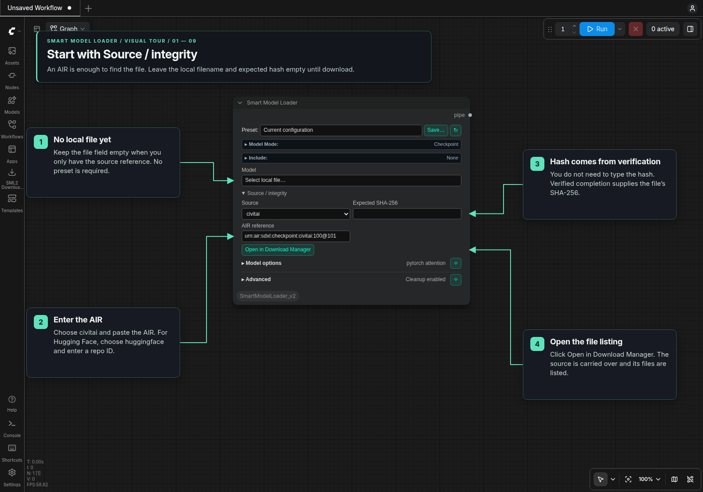
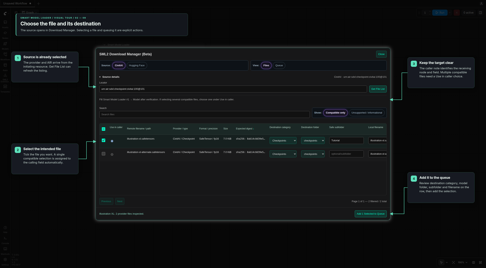
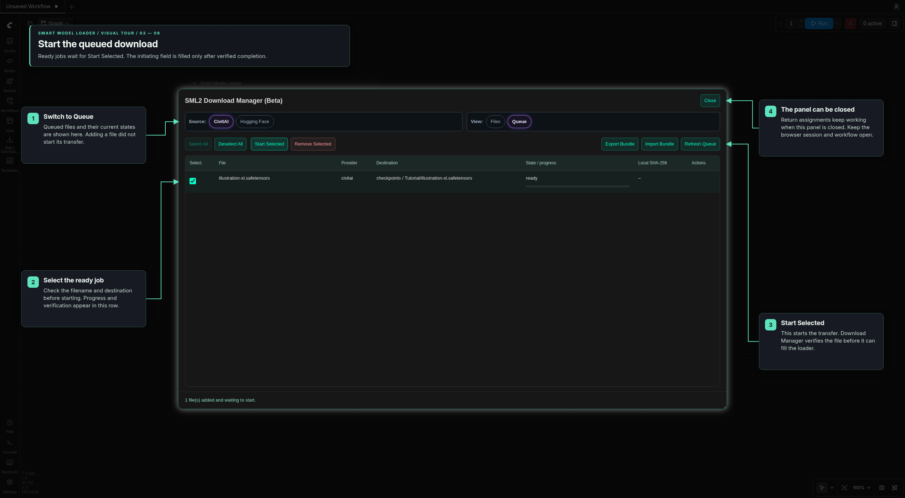
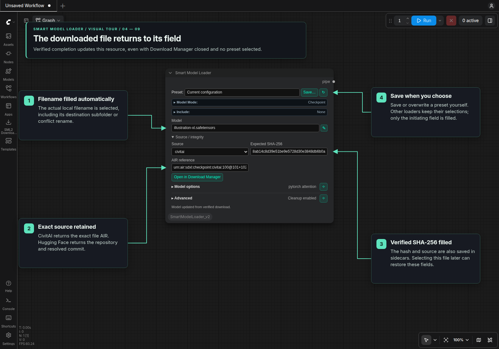

# SML2 Download Manager (Beta)

Download Manager lists and downloads model files from CivitAI and Hugging Face.
Open it from a resource's **Source / integrity** controls to return the completed
download to that exact field, or use the standalone launcher to manage files.

## Visual tour

This tour uses the actual Nodes 2.0 controls with illustrative AIRs and small
local download fixtures. The same flow works in classic canvas. The example
starts without a local filename, expected hash or selected preset.

### 1. Enter only the source

Expand **Source / integrity**, choose **civitai**, and paste an **AIR reference**.
Leave the filename and **Expected SHA-256** blank if you do not have the file yet.
For Hugging Face, choose **huggingface** and enter the **HF repository**, with an
optional revision. Then click **Open in Download Manager**.

### 2. Select the file and destination

The manager receives the provider and reference and fetches its file list.
Select the intended file and review its destination category, model folder,
subfolder, local filename and conflict policy. The caller note identifies the
node and field that will receive it. One compatible selected file is assigned
automatically; with several, choose one under **Use in caller**.

Click **Add Selected to Queue**. This creates a ready job; it does not start the
download. Scroll the file table horizontally if destination columns are outside
the current dialog width.

### 3. Start the ready job

Open **Queue**, select the job and click **Start Selected**. The manager transfers
the selected file and verifies it before completion. You can close the manager
while it works; the download and return assignment continue in the same browser
and workflow session.

### 4. Receive the filename and verified metadata

After verified completion, the originating resource receives the actual local
**filename**, exact **source** and **SHA-256** automatically. Subfolders and any
conflict rename are included. Other rows and loaders keep their selections.
Source/hash sidecars let later local-file selections restore this metadata too.

Save or overwrite a preset yourself if you want to retain the new setup.
The download does not save a preset. Editing the target's file/source while a
download waits cancels that pending return; reloading the browser drops return
assignments, so select the downloaded file manually afterward.

The same flow applies to external **CLIP**, **VAE/audio VAE** and **LoRA** resources.
For an empty LoRA Stack row, open its **i** button and follow the
[AIR-only LoRA example](LoRA_Stack.md#download-a-lora-from-an-air-only-row).

## Opening the manager

- Choose **Open in Download Manager** in a resource's **Source / integrity** controls to keep its return target.
- Left toolbar: choose **SML2 Download Manager (Beta)**. The launcher sidebar closes immediately while the modal stays open.
- SML2 menu: choose **SML2 → SML2 Download Manager (Beta)**.
- Classic menu: use the **SML2 Download Manager (Beta)** button in the legacy top menu.

The manager uses the shared Jade design with comfortably sized controls. The separate **Source** and **View** bars share the top row, with Source first. Choose **CivitAI** or **Hugging Face** under Source, and switch between **Files** and **Queue** under View. Selected options use the same purple highlight as the loader forms.

**Source details** can be collapsed by clicking its heading. Collapsing it keeps the locator and revision values. Opening a source from a loader shows its provider, locator and revision and retrieves the file list. Files enter the queue only when you select **Add Selected to Queue**.

On desktop, drag the dialog's lower-right edge to resize it. The manager stays within the viewport; file tables scroll independently, and the controls wrap on narrow screens.

## Inspecting provider files

Choose a provider, enter a locator, and select **Get File List**.

CivitAI accepts:

- AIR identifiers, including exact `+fileId` AIRs;
- full SHA-256 values;
- model-version URLs; and
- canonical model download URLs.

AutoV1/2/3, CRC32, and BLAKE3 are not accepted as provider identities. Every downloadable file in the resolved version is shown, but files without an authoritative SHA-256 cannot be selected.

CivitAI sometimes publishes the same REST/download basename for several precision variants. The manager performs the same bounded, identity-checked author-filename lookup as Smart Model Loader and uses the result as the editable local filename suggestion. The original REST filename remains visible and stays in the immutable provider identity. If author metadata is unavailable or fails its file-ID/SHA-256 checks, a precision-aware, collision-safe fallback is used instead.

Hugging Face accepts:

- `owner/repository` IDs;
- repository URLs;
- canonical `/blob/` or `/resolve/` file URLs; and
- an optional revision.

The revision resolves to one immutable 40-character commit before files are listed. LFS and Xet-backed files use their upstream SHA-256. Regular Git files use their Git blob identity; users do not need to supply hashes.

## Filling the caller's file field

When opened through a node's **Open in Download Manager** button, the manager
remembers that specific node and field. A verified completion fills its final
local filename (including subfolders or conflict renaming), source and SHA-256.
This works for Smart Model Loader's model, external CLIP, VAE/audio VAE and LoRA
fields, CLIP Loader encoder rows and LoRA Stack rows. No preset is required; AIR
and HF repository references can be entered manually. Saving a preset remains a
separate user action.

Verified downloads also save their source and SHA-256 beside the local file.
Selecting that file later in a loader fills its source/integrity fields from
these sidecars, even after its queue entry is removed. CivitAI saves the exact
file AIR; Hugging Face saves its repository and immutable commit. Verified skips
of existing files also record this information. For older downloads with only a
hash sidecar, the loader can read missing source information from retained,
verified queue history while the file still matches its verification record.

One selected file in the caller's category is used automatically. If you select
several compatible files, choose one in the **Use in caller** column before
queuing. Other selected files download normally. The manager shows which node
and field will receive the file; another loader opening it does not redirect
downloads already queued for the previous caller.

Closing the manager keeps queued return assignments active. Reordering rows keeps
their assignments too. Changing the target's file/source, resetting or removing
the node, or replacing the workflow cancels its pending assignment. Unrelated
seed or sampler edits do not cancel it. Failed or unverified downloads never
replace a field. A filename that resolves to a different file in another model
root is rejected; use a unique destination name in that case.

Automatic filling belongs to the current browser/workflow session. Reloading the
page drops pending field assignments while downloads remain in the persistent
queue. Completed downloads refresh local file lists and already-open pickers;
you can also select downloaded files manually. No provider lookup, download or
preset save is triggered by restoring a workflow.

## Choosing destinations

The destination grid uses ComfyUI's registered model-storage folders, with the configured `models` directory preferred by default. Choose a **Destination category**, then its **Destination folder**, such as `diffusion_models`, `unet`, `text_encoders`, `clip`, `audio_encoders` or `checkpoints`. ComfyUI's output folders are excluded from every category. Additional registered model-storage locations remain available; matching folder names show enough parent context to distinguish them. Repeated registrations of the same path appear once, and arbitrary filesystem paths and `custom_nodes` are not accepted.

**Diffusion Models** includes both registered `diffusion_models` and legacy `unet` roots. Modern roots are selected by default when available; explicitly choosing `unet` downloads into that folder. The selected root stays the destination when jobs are restored, retried or imported from bundles. GGUF files use the same **Diffusion Models** or **Text Encoders** categories as other model files; the picker does not expose separate GGUF registry aliases.

Use the suggestion as a starting point, then confirm ambiguous model files. Set the destination category, registered folder, subfolder, local filename and conflict policy directly on each file row, before or after selecting it. These values and selections persist while paging or filtering the current listing. **Select all** selects supported files on the current page; deselecting the page keeps selections on other pages. Only explicitly selected files enter the queue. Subfolders must be relative and traversal-free; local filenames must remain basenames and preserve the provider file extension.

Default format policy:

- Safetensors and SFT are accepted by compatible model categories.
- GGUF is accepted only for diffusion-model and text-encoder categories.
- `.pth` is accepted for **Upscale Models**.
- `.pt` is accepted for **Embeddings**.
- `.pth` is not accepted for **Latent Upscale Models** by default.
- `.ckpt`, `.pkl`, `.bin`, and other `.pt`/`.pth` uses require the administrator's **Allow Legacy Model Formats** override.

Use **Unsupported / informational** in the **Show** bar to include rows that cannot be selected and see the reason beside each filename.

## Persistent queue

Saved jobs retain their selected model folder, including an explicit `unet` choice. An older job or imported bundle targeting an output folder cannot start a new download there; choose a model-storage folder for a new queue entry. Existing downloaded files and partial data remain in place until explicitly managed.

New and imported entries are added in the **ready** state and do not download automatically. Select one or more ready entries in the Queue tab and choose **Start Selected**; the manager then processes the started transfers one at a time. **Remove Selected** deletes ready or finished queue records without deleting downloaded model files. Queued or active transfers must finish or be cancelled before their records can be removed. A cancelled or failed entry with retained partial data must be retried or use **Delete Partial** before its queue record can be removed.

The manager stores its schema-versioned queue atomically in the gitignored `download_manager/` directory. Queue records contain immutable provider identity, destination assignment, expected provider digest, local SHA-256, byte size, conflict policy, progress, timestamps, and sanitized errors. They never contain credentials, authorization headers, or temporary signed URLs.

Interrupted work returns to the active queue after restart. Download Manager cancellation also retains already transferred bytes so **Retry** can resume the explicitly selected provider file. A partial transfer resumes only when the remote server returns consistent range metadata. **Delete Partial**, shown beside Retry when retained data exists, explicitly discards those bytes and makes the next attempt start from zero. Hashing, verification, locking, and atomic promotion are intentionally non-abortable.

Conflict policies are:

- `skip`: keep an existing destination and record whether it matches provider identity. A skipped job can be completed with an unverified file; only a verified match fills the calling loader;
- `rename`: choose a contained collision-free local filename; and
- `overwrite`: atomically replace the existing file only after provider verification.

Every completed transfer receives a local SHA-256 sidecar. Verified transfers and
verified skips also save the exact CivitAI AIR or HF repository/commit and the
file's SHA-256 in the source sidecar. A local digest alone is not a verified match.

## Download bundles

Queue selections can be exported as download bundles. Bundles preserve immutable provider identity, expected digest, category, registered root index, relative path, local filename, local SHA-256, and conflict policy.

## Security boundary

Provider inspection and queue mutations use bounded JSON requests, same-origin browser checks, and loopback-only global access in ComfyUI multi-user mode. Destinations are resolved from server-owned folder registrations, reject absolute paths, traversal, symlinks, and escapes, and are promoted only after immutable provider verification.

The manager does not make unsafe pickle formats safe. Leave the legacy-format override disabled unless an administrator has independently trusted those artifacts.
