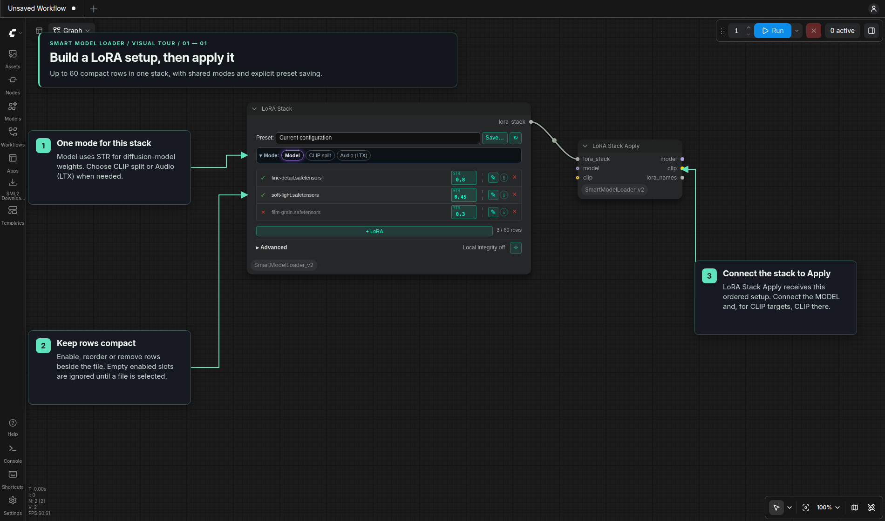
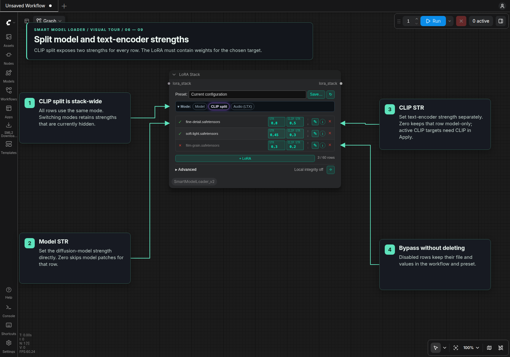
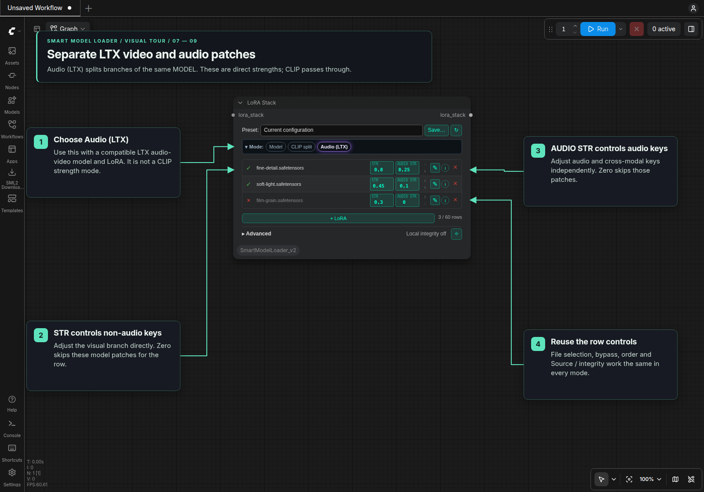
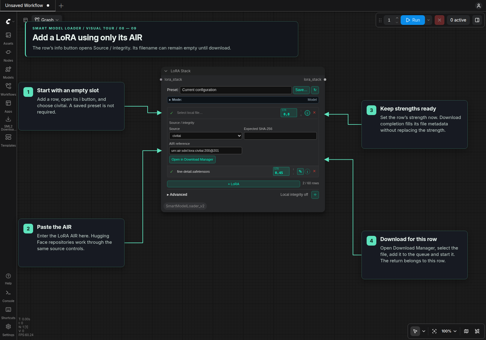
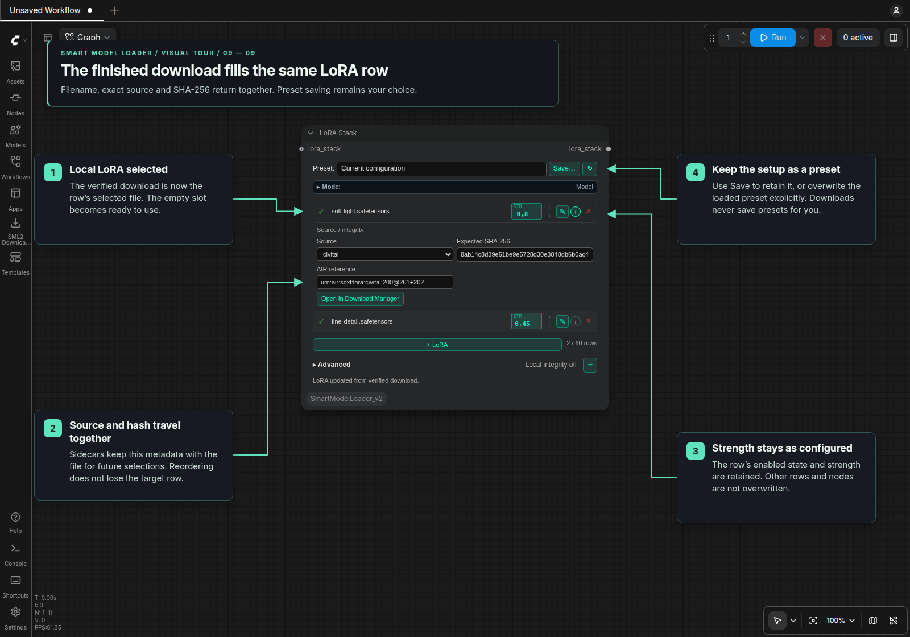

# LoRA Stack

Add **LoRA Stack** and **LoRA Stack Apply** from
**Smart Model Loader v2 → Tools**. Connect the stack output to Apply's
`lora_stack` input, then connect the MODEL and/or CLIP used by your rows.
Apply outputs `model`, `clip`, and a `lora_names` string containing each
enabled row's filename and selected strengths.

The Jade editor works in classic canvas and Nodes 2.0. **+ LoRA** adds an
actual row, up to **60 rows per node**. An empty stack passes through unchanged.
Configure the complete setup in this node; it has no incoming stack socket.
The stack uses the `SML2_LORA_STACK` socket to carry its targets and integrity metadata.
Use **LoRA Stack Apply [SML2]** with it.

## Visual tour

These screenshots show the actual Nodes 2.0 controls with illustrative local
filenames. Classic canvas uses the same editor. Downloads below use a small
local provider fixture to demonstrate verified completion.

### Build and apply the stack

Add rows with **+ LoRA**, choose files and adjust **STR**. The left button
bypasses a row while keeping its values; arrows change order, **✎** renames the
file and sidecars, **i** opens **Source / integrity**, and **×** removes the row.
Connect `lora_stack` to **LoRA Stack Apply**, with the MODEL and/or CLIP needed
by the selected targets. **Save…** stores the current setup as a preset.

### Choose model and CLIP strengths

**Model** exposes one STR for compatible diffusion-model weights.
**CLIP split** exposes **STR** and **CLIP STR** for every row. A zero strength
skips that target. CLIP strength requires text-encoder weights in the LoRA and
a connected CLIP in Apply. Changing modes retains hidden strength values.

### Split LTX video and audio branches

**Audio (LTX)** uses **STR** for non-audio model keys and **AUDIO STR** for audio
and cross-modal keys. Both patch the same compatible LTX audio-video MODEL;
CLIP passes through. Values apply directly, without a separate master multiplier.

### Download a LoRA from an AIR-only row

Add an empty row, click **i**, and choose **civitai** under **Source / integrity**.
Enter only the **AIR reference**; the filename and expected hash can stay empty.
Set the strength now if you want. No preset is required.

Click **Open in Download Manager**, select the file, **Add Selected to Queue**,
then **Start Selected**. See the [Download Manager tour](Download_Manager.md#visual-tour)
for those steps. Opening the panel or running the workflow does not start a download.
Until a local filename is filled, an empty LoRA slot is ignored during execution.

### Let completion fill the row

Verified completion selects the downloaded filename and fills its exact source
and SHA-256 in that same row. Strength and enabled state stay as configured;
reordering the row does not lose its pending assignment. Other rows and nodes
are not overwritten. Closing Download Manager is fine while the browser session
and workflow stay open.

Use **Save…** afterward to create or explicitly overwrite a LoRA preset.
Downloads never save presets automatically.

## Mode and row controls

Select a local LoRA with the searchable file button. The picker refreshes when
opened. Move rows with the arrows, remove them with **×**, or use the left
enable button to bypass a row while retaining its configuration. Repeated files
and negative strengths are supported; zero strength skips that target.
An empty slot is ignored during validation and loading, even when enabled.
It remains in the editor and saved setups until you select a file or remove it.

The collapsible **Mode** bar applies to every row in this node. **Model** is
the default. Rows stay on one line, with one or two strength fields depending
on the mode. Switching modes retains the hidden strengths; new rows start at 1.

| Mode | Row fields and what they patch |
| --- | --- |
| Model | STR applies to all compatible diffusion-model weights; CLIP passes through |
| CLIP split | STR applies to the model; CLIP STR independently applies to compatible text-encoder weights |
| Audio (LTX) | STR applies to non-audio model weights; AUDIO STR applies to keys containing `audio`, including cross-modal keys; CLIP passes through |

Video and Audio both patch the **same MODEL**. CLIP is a separate text encoder.
In Model mode, STR applies to the full compatible model LoRA, including audio
weights. Audio (LTX) splits those branches with direct strengths. Set either
strength to zero to skip that branch. In CLIP split, STR = 0 gives a CLIP-only
row and CLIP STR = 0 gives a model-only row.

Smart Model Loader's built-in LoRA section has one shared strength for model and
compatible CLIP weights on the standard loading path. Use this stack's **Model**
mode to leave CLIP unchanged, or **CLIP split** for independent strengths.
When working with a PIPE, extract model/clip with IO Checkpoint Loader, apply the
stack, then merge Apply's outputs into the pipe through another IO Checkpoint
Loader before conditioning and sampling.

CLIP strength applies when the LoRA contains compatible text-encoder weights.
Audio (LTX) has no CLIP strength control. STR 0.7 and AUDIO STR 0.2 apply those
direct weights. Split model targets require ComfyUI's LTX audio-video model (`LTXAV`);
they are rejected for unrelated models and Nunchaku backends.

Nunchaku Flux and Qwen retain the existing native wrapper adapters, including
compiled-wrapper handling and offload settings. Their model rows are passed to
the adapter together in order. Separate model branches retain their own LoRA
settings, including when sampling switches back to an earlier branch.
CLIP targets use ComfyUI independently and
CLIP-only rows do not replace a Nunchaku model's LoRA list. ZImage retains its
native patcher through ComfyUI's clone/add-patches API. The controls cannot make
an incompatible LoRA architecture compatible with a model or encoder.

## Presets and files

The preset panel saves the shared mode and all local rows, including their order,
bypass state, source/hash metadata and all strengths. It remembers the loaded
name for updates and provides explicit overwrite and confirmed deletion.
Presets live in `templates/lora-stack/`, separately from model presets in `templates/`.
The node's Local integrity policy stays outside presets. Loading a preset keeps Mode and Advanced collapsed or expanded as they were.
The toolbar reset restores an empty stack and supports Undo.

Missing filenames remain visible and marked **Local file missing**. An enabled
row with a selected filename must resolve to an allowed local file. A disabled
missing row is retained without being loaded. Apply validates all active files, required inputs and
integrity policies before applying patches. Missing inputs produce an error
identifying which row's Model or CLIP target needs a connection.

The row's **i** button exposes Source / integrity. An AIR or HF repository can
be handed to Download Manager by clicking **Open in Download Manager**. That
click fetches the file listing; loading a workflow or preset does not inspect
providers, queue files or download automatically.
The filename can be empty when only an AIR or HF reference is available.
After an explicitly started download verifies, its filename, exact source and
SHA-256 fill the same row automatically. Save or overwrite a preset explicitly.
Selecting a local LoRA reads its saved source and SHA-256 from sidecars, with
matching verified download history supplying source information for older downloads.
Each row retains its own pending lookup when reordered; newer manual edits win.

Advanced's **Local integrity** checkbox defaults to Verify when enabled.
Verify uses an entered expected SHA-256 or saved expected metadata. The sidecar
policy records a local digest instead. Verification happens in Apply before
loading LoRA tensors.

The small square **✎** button immediately before each row’s info icon opens
Rename for the selected LoRA file. It renames
the file in its current folder, keeping the extension, together with its
`.sha256` and `.eclipse.json` source/hash sidecars (including an unambiguous
legacy `.sha256` sidecar). Only the initiating field and its local file list are
updated. Other loaders and saved presets keep their filenames; select the new
file there and save or overwrite presets explicitly. Existing destination files
are never replaced. Finish queued prompts/downloads before renaming.
