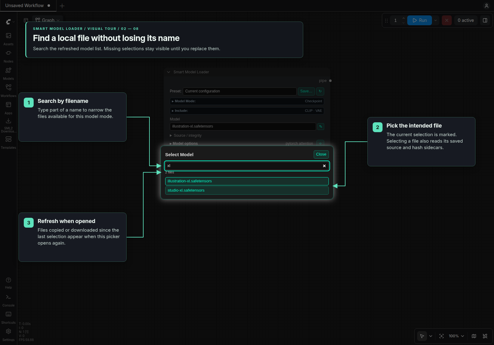
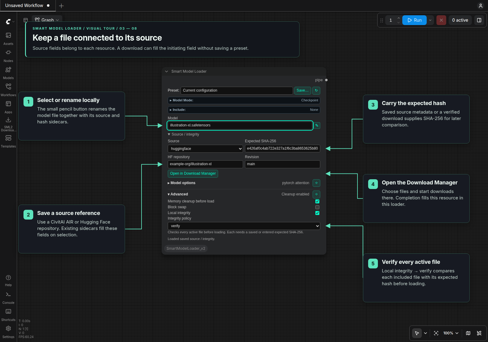
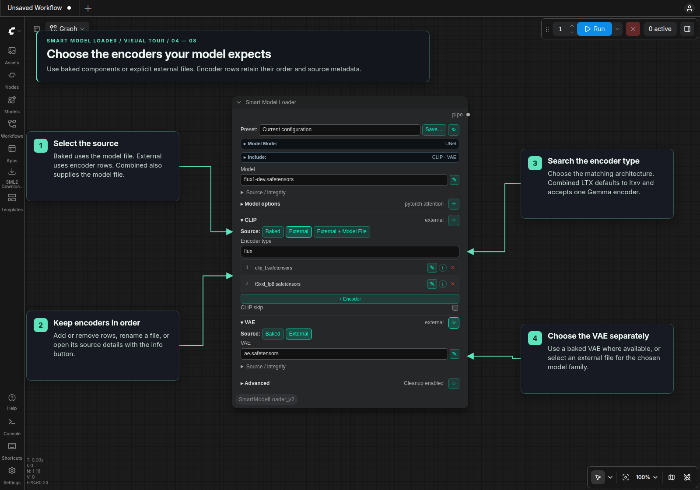
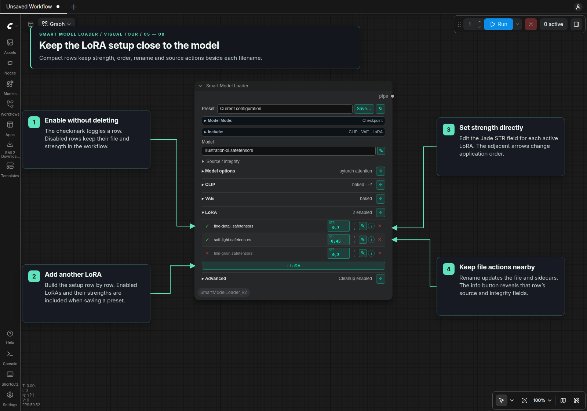
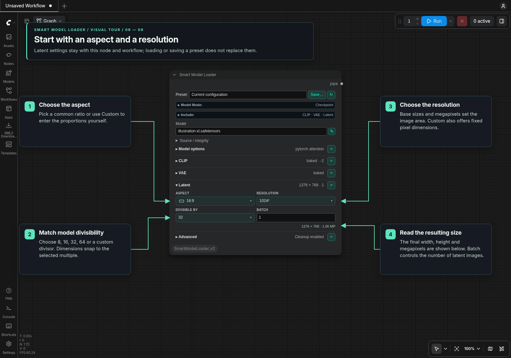
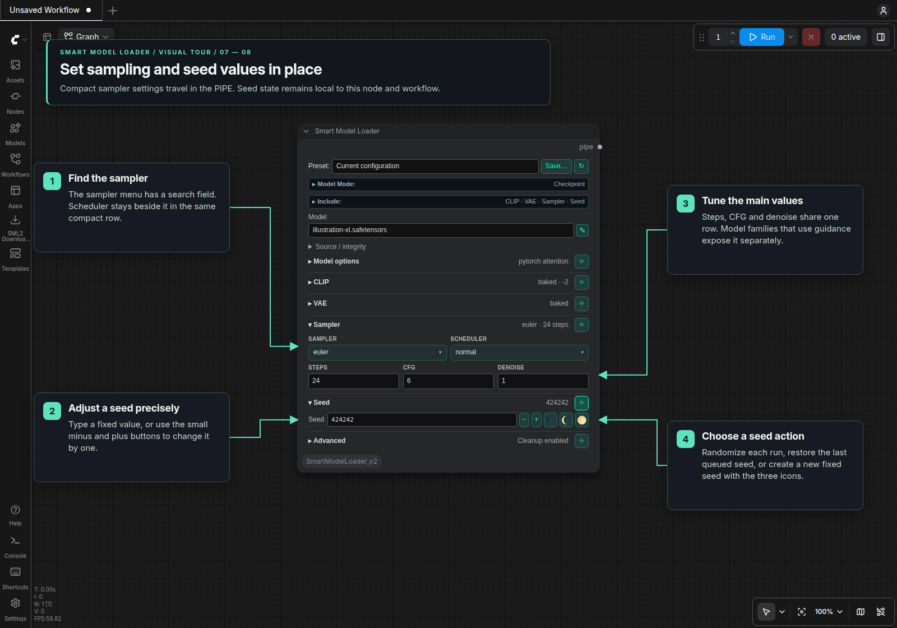
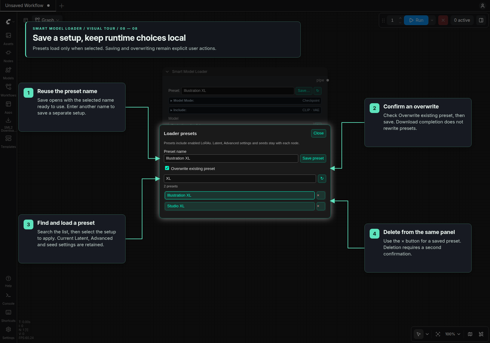

# Smart Model Loader

Add **Smart Model Loader [SML2]** from the Smart Model Loader Nova category. It has a
compact panel that works in classic canvas and Nodes 2.0. Its
design is adapted from DaSiWa, with compact 11px Model Mode and Include bars.
Include sits directly below Model Mode. The panel follows the node's
background color, including later color changes, while its controls keep Jade
accents. Repeated file rows use a subtle tint over the node background.

## Visual tour

These screenshots show the current node in a running Nodes 2.0 interface with
illustrative local filenames. Classic canvas uses the same controls. The Jade
annotations follow the Eclipse visual-tour layout.

### Build the setup and connect its PIPE

Choose **Model Mode**, then enable the sections you need in **Include**. Closed
sections retain their values; pin a section to keep it open while editing another.
Connect the PIPE to **IO Checkpoint Loader** for individual outputs or continue
it to **KSampler Pipe**.


### Find a local model

Opening the file selector refreshes its list. Search by part of the filename and
choose the file you intend to use. A missing workflow selection remains visible
in the node until you replace it.



### Keep source and integrity with each resource

Selecting a file reads its existing source/hash sidecars. The rename button
renames the file and its sidecars together. **Open in Download Manager** carries
the source into the manager; after an explicitly started, verified download, the
originating resource receives the filename, source and hash. Save the preset
yourself when you want to retain the updated setup.

**Local integrity → verify** checks every active file before loading. Each file
needs an expected SHA-256 from its own saved or entered metadata.



For the complete AIR-only example, follow the
[Source / integrity → Download Manager tour](Download_Manager.md#visual-tour).
It shows the file listing, queue, explicit start and automatic filename/hash return.

### Choose external encoders and a VAE

Select the encoder architecture from its searchable type list and keep the
required files in order. CLIP and VAE have independent source choices. For LTX
with **External + Model File**, use one Gemma encoder and a model containing its
text projections; new combined-source selections default to **ltxv**.



### Adjust the LoRA setup

Toggle rows without discarding their values, edit **STR**, and reorder the active
LoRAs. Rename and info actions sit beside each filename. Enabled LoRAs and their
strengths are included when you save a Smart Loader preset.



### Set latent aspect, resolution and divisibility

Choose an aspect and a base size or megapixel target. **Custom** provides editable
ratios and fixed pixel dimensions. Set the divisor required by the model and
check the resulting dimensions below the controls. Latent settings stay with
the node and workflow when presets are loaded or saved.



### Configure sampling and seeds

Search the sampler menu and set scheduler, steps, CFG and denoise. Seed supports
exact manual entry, small minus/plus buttons, and icons for randomizing each run,
restoring the last queued seed and creating a new fixed seed. Sampler settings
enter the PIPE; seed state stays local to the node and workflow.



### Save or update a preset explicitly

**Save…** remembers the selected preset name. Enable **Overwrite existing preset**
to update it, or enter a new name for another setup. Search and load presets from
the same panel; the delete button asks for confirmation. **Latent, Advanced and
seeds** stay with each node, while enabled LoRAs are part of the saved preset.



## Controls and behavior

Click **Model Mode** or **Include** to collapse that bar after making selections.
Each closed bar shows its current selection on one line; hover for the complete
summary if it is shortened. Click again to reopen. Both bars start expanded,
remember their state in workflows, and keep that state when loading a preset.

Choose Checkpoint, UNet, GGUF, Nunchaku Flux, Nunchaku Qwen, or Nunchaku ZImage,
then select a local model. **Include** enables CLIP, VAE, Audio VAE, LoRA, Latent,
Sampler, Model sampling, and Seed sections. Section headings expand their controls;
the pin button keeps additional sections open. Disabling a section keeps an editor
draft in the workflow and excludes it from execution.
**Model options** sits below the model's **Source / integrity** controls, inside
the same model group and above the separator for optional sections.

Checkpoint and UNet modes offer baked components when their model file actually
contains those weights. GGUF and Nunchaku modes use external components.
Selecting Baked does not supply missing weights; choose External for files that
do not include them. Loading baked CLIP or VAE in UNet mode requires the default
weight dtype.

Selecting a model, CLIP encoder, VAE/audio VAE or LoRA reads its existing sidecars
into **Source / integrity**. Saved AIR or HF repository/revision and expected
SHA-256 values take priority. A valid `.sha256` sidecar can supply a local baseline,
identified as such in the form; JSON hash sidecars must match the file's current
size and modification time. Older downloads whose sidecars lack source information
can recover it from matching verified Download Manager history.
Selection does not hash files, write sidecars or contact a provider. Choosing a
different file clears its previous source/hash. Manual edits made while metadata
is loading are preserved, and simultaneous selections in different rows or nodes
remain independent.

Use **Open in Download Manager** in a resource's Source / integrity controls to
open its CivitAI AIR or Hugging Face repository and fetch the file listing. An HF
revision is carried over too. Choose the files, variants, and destinations in the
manager, then use **Add Selected to Queue** and **Start Selected**. Lookup errors
appear there with the reference still available for correction. An empty source
opens the manager for manual entry. Opening a workflow or editing a reference
does not contact a provider.

Changing a model, encoder, VAE, or LoRA file clears that resource's previous source
and hash. Selecting the same file keeps them. A verified download launched from
that resource automatically fills its actual local filename, source and SHA-256.
This applies to the model, external CLIP rows, VAE/audio VAE and LoRA rows, including
manual sources with no preset. Other loaders keep their selections. File lists
and open pickers refresh when downloads complete; opening a picker also refreshes
its list for files copied externally. If several compatible files are selected,
choose one under **Use in caller** in the manager. Save or update a preset manually
afterward if wanted. See the [Download Manager guide](Download_Manager.md#filling-the-callers-file-field)
for session and edit handling.

**Encoder type** opens a searchable list using the same panel as local file
selection. The current type is highlighted; use the arrow keys and Enter to
select a type, or Escape to cancel.

For LTX with **External + Model File**, a new source selection defaults to
**ltxv** and uses exactly one external Gemma encoder. The checkpoint or UNet
must contain its text projection weights; this is checked before memory cleanup
or model loading. Single and paired video/audio projections are supported.
Safetensors checks read only the header. Extra rows from a saved configuration
remain visible for removal and block execution. Use **External** when the
projections are in a separate encoder file. Existing source drafts and explicitly
selected encoder types are retained when switching sources.

**CLIP skip** is optional for both baked and external encoders. Enabling it
reveals **Stop at layer**. Its effect depends on the text encoder, not whether the
model was loaded as Checkpoint, UNet or GGUF. Encoders with fixed feature-layer
selection can ignore it. Switching CLIP sources retains the current skip setting.

CLIP supports up to four external encoder rows. LoRA rows can be added, disabled,
removed, and reordered; up to 256 rows are supported, subject to available memory.
Both use compact file rows. LoRA strength is
editable directly in the Jade **STR** field; the **i** button expands a row's
source and integrity settings. The checkmark toggles a LoRA, arrows change its
order, and **×** removes the row.
On the standard loading path, STR applies equally to compatible model and CLIP
weights in the LoRA. Nunchaku Flux/Qwen use their model adapters and leave CLIP
unchanged. For independent model/CLIP strengths, model-only application, or LTX
video/audio splitting, use [LoRA Stack and Apply](LoRA_Stack.md).

Model-specific options and sampling parameters appear only where applicable.
Nunchaku's **CPU offload → auto** lets the backend decide from available VRAM;
**enable** and **disable** remain explicit choices.
Flux and Qwen sampling use this node's latent dimensions when Latent is enabled.
Latent creation requires a compatible image VAE; video and audio latent creation
belongs in the corresponding latent nodes. Sampler settings populate the PIPE.

**Latent sizing** uses compact, grouped **Aspect** and **Resolution** menus with
ratio previews. Base sizes such as **1024²** set the target pixel area; MP presets
use decimal megapixels. **Divisible by** offers 8, 16, 32, 64, or a custom positive
integer, starting at 32 for newly enabled Latent sections. Dimensions round to
the nearest multiple, with ties rounded up. The actual width × height and MP
remain visible below the controls.

Choose **Custom** under Aspect to enter a width:height ratio. Choose **Custom**
under Resolution for **Megapixels** or **Fixed pixels**. Fixed pixels exposes
width and height and derives the aspect display from them. Existing saved
dimensions open as Custom / Fixed pixels without changing their size. Changing
the sizing controls applies the selected divisor and shows the resulting size
before generation. Batch controls the number of latent images.

Latent is a runtime option: its enabled state, active sizing choices, batch size
and inactive mode drafts stay with the node in the workflow. Presets neither save
nor replace them. Execution validates that the saved dimensions agree with
the sizing choices and the loaded VAE's spatial requirements. It does not resize
silently or infer a model's required divisor from its filename.

**Sampler** puts Sampler and Scheduler side by side in compact Jade menus, with
Steps, CFG, and Denoise on one row below. Applicable Flux guidance joins that row;
on narrow nodes the four numeric fields use two rows. Hover a shortened selection
to read its full name. Menus open at the selected option and support keyboard
navigation. Saved values, ranges, and PIPE settings retain the same behavior.

**Flux guidance** is stored in the PIPE; it does not alter conditioning by itself.
Expose `flux_guidance` through IO Checkpoint Loader, connect it to a
**FluxGuidance** node, and pass that node's conditioning output to the sampler.
KSampler Pipe consumes its sampler settings but does not apply guidance for you.

Presets save model settings and enabled sections under `templates/`, including
denoise, resource references, encoder arrays, and enabled LoRAs with their strengths.
**Latent, Advanced settings and seeds are excluded.** Applying a preset keeps the
current node's latent settings, memory cleanup, block swap, local integrity, seed
value/mode, and last-used seed. Disabled Latent and Seed stay disabled and retain
their drafts. Earlier templates containing Latent remain readable, but their
latent settings are ignored and removed only when the user saves them again.
Flux and Qwen model sampling use the current runtime latent when enabled. With
Latent disabled, a preset's explicit sampling dimensions apply; otherwise the
node keeps its previous sampling size, defaulting to 1024 × 1024 on a new node.

Click the preset name to open the **Loader presets** panel. Search the list and
click a preset to load it. **Save…** opens the same panel with the name field
focused and prefilled from the last preset loaded or saved by that node. The name
is remembered in workflows and clones. Keep it to update the preset, or enter
another name to save a copy. For an existing name, check **Overwrite existing
preset** before saving; malformed existing presets are preserved.

Each list row has a **×** delete button followed by a confirmation naming that
preset. Deletion removes its saved configuration file and keeps the node's loaded
settings. Bundled presets are extracted only during initial setup; deleted presets
stay deleted after restarting or updating the pack. Deletion is available when
the prompt queue is idle. Refresh updates the list;
opening the panel also refreshes it.

The toolbar's **↻ Reset loader to defaults** button clears the loaded configuration,
remembered preset name, and inactive drafts, restoring a new loader's defaults.
Use ComfyUI's Undo to restore the previous configuration. Preset and local-file
pickers refresh their lists whenever opened, so newly added files appear without
resetting the loader. Refreshing a list preserves current selections, including
missing filenames, and any search or save name being typed.

A preset is applied only when its list entry is clicked. Queuing or reopening a
workflow does not reapply it; workflows restore their saved node settings. The
remembered name is editor metadata and does not enter execution settings or the
preset itself.
Loading a preset preserves open, collapsed, and pinned sections that remain
included. Newly included sections start collapsed. If every section is closed,
it stays that way when loading a preset or reopening the workflow.

To import an old Smart Model Loader template, copy its JSON file into this pack's
`templates/` folder and select it in the preset panel. The loader reads its v1
settings into the new form and shows a **V1 template loaded** reminder. Choose
**Save…**, keep the name, check **Overwrite existing preset**, and save to convert
the file permanently. Enter another name to save a converted copy instead.
Loading alone leaves the original file unchanged; v1 nodes do not need to be
installed. Already converted presets load directly without the reminder.

Current presets use structured `model`, `clip`, `vae` and other section objects.
Their `"version": 1` identifies the configuration schema. Legacy templates use
flat fields such as `model_type` instead.

Conversion retains the selected model, backend options, enabled component and
sampler sections, active LoRAs, and filename-bound AIR/SHA-256 metadata. Missing
local filenames remain visible. Latent, Advanced settings and seeds stay with the
current node. Invalid templates and unavailable sampler/scheduler choices are rejected
without rewriting their files or substituting other settings.

Seed uses one row with the value, small **− / +** buttons, and three icon actions:
**🌑 Randomize each run**, **🌘 Use last queued seed**, and **🌕 Create fixed random
seed**. Tooltips name the actions; the last-seed tooltip also shows the saved
value. A normal number is fixed; `-1` randomizes each run, and `-2`/`-3` increment
or decrement from the last queued seed. There is no after-queue dropdown.
Without a previously queued seed, `-2`/`-3` start from a random value.

Manual **− / +** changes the seed by one and switches it to fixed mode, starting
from the last queued seed when random mode is selected and one is available.
Manual stepping stops at 0 and 18446744073709551615. Automatic increment/decrement
wrap at these unsigned 64-bit bounds.
Only accepted queue submissions update the last queued value. Edits made
during submission are preserved, and the submitted workflow records its exact
concrete seed. Saving, cloning, and previewing do not advance it.

**Advanced → Local integrity** applies to every active local file: the model,
external CLIP encoders, VAEs, and enabled LoRAs. Baked components share their
containing model file's check. The checkbox starts unchecked and skips hash
checking. Checking it reveals **Integrity policy** with **verify** selected;
unchecking it hides the policy controls and turns checking off. **sidecar** records
local SHA-256 baselines without comparing them to an expected hash; **verify**
compares each file against its entered SHA-256 or saved `.eclipse.json` expected
hash before loading. Up-to-date hash caches avoid redundant hashing. A missing
expected hash or a mismatch stops loading.

The Download Manager obtains provider digests and verifies downloads. Verified
downloads save the exact CivitAI AIR or HF repository and immutable revision,
together with the file's SHA-256, in `.eclipse.json`. This also applies when an
existing file is skipped and successfully verified. HF Git blob SHA-1 values never
populate the SHA-256 field; the saved SHA-256 is computed from the verified file.
The local `.sha256` baseline remains separate. An AIR or HF repo ID alone is a
source hint; it does not establish file verification.

The small square **✎** button opens Rename. In LoRA rows it sits immediately
before the info icon; other file selectors keep it beside the filename. It renames
the file in its current folder, keeping the extension, together with its
`.sha256` and `.eclipse.json` source/hash sidecars (including an unambiguous
legacy `.sha256` sidecar). Only the initiating field and its local file list are
updated. Other loaders and saved presets keep their filenames; select the new
file there and save or overwrite presets explicitly. Existing destination files
are never replaced. Finish queued prompts/downloads before renaming.

**Advanced → Block swap** appears only when ComfyUI's native DynamicVRAM is
inactive and the selected model backend supports manual block swapping. When
DynamicVRAM is enabled, saved block-swap settings stay as inactive workflow data
and are excluded from execution. They can be enabled again on a server without
DynamicVRAM. Saved API configurations also skip block swapping while it is active.

Use **IO Checkpoint Loader** to expose individual values from the PIPE. For
model-only loading, disable unneeded Include options. For LTX encoders with
projections in the model, use the **External + Model File** CLIP source.

## Qwen Image 2.1

Use a ComfyUI version that provides `TextEncodeQwenImage21` and native Qwen Image 2.1 VAE support. The conditioning node still registers on older installations, but execution reports missing upstream encoder support.

### Model selection

- Load the Qwen Image 2.1 diffusion model using the appropriate existing loader model type.
- Select **External** CLIP and the existing **`qwen_image`** type with compatible **Qwen3-VL-8B** text-encoder weights. ComfyUI selects its Qwen Image 2.1 encoder from the weight architecture; there is no separate `qwen_image_2.1` CLIP type. Older Qwen Image encoders are not interchangeable with this encoder.
- Select **External** VAE and a Qwen Image 2.1 RGBA VAE. Native `qwen_image_2.1_vae_bf16.safetensors` and Diffusers `qwen21HDRVAE_diffusersFormat_fp16.safetensors` are supported by the shared external VAE loader, including the standalone VAE Loader.

Use the VAE for Qwen Image 2.1; the original Qwen Image VAE is not interchangeable.
Sampling can finish with a mismatched VAE and then fail when decoding the latent.

The Diffusers format is detected from tensor keys and shapes, independently of its filename. The loader maps its blocks, attention, normalization, resampling, and quantization weights to ComfyUI's native architecture, adding singleton temporal dimensions where needed. It validates every converted key and shape and rejects malformed recognized files. Conversion preserves tensor values, dtype, and file metadata in memory; native files pass through unchanged and neither file is rewritten. ComfyUI retains control of inference device and compute dtype. This architecture uses 64 latent channels, 16× spatial compression, and four output channels; RGB input receives opaque alpha.

### Text Encode Qwen Image 2.1

Find **Text Encode Qwen Image 2.1** under **Smart Model Loader Nova → Conditioning**. Its serialized ID is `Text Encode Qwen Image 2.1 [SML2]`.

Connect `clip`, `vae`, `positive`, and `negative`, in that order. Both prompts are STRING sockets, with no prompt widgets. Connect a string-producing node for each prompt; an empty string is valid.

`image_1` and `image_2` are always visible and optional. Connecting the last visible image socket adds another, up to `image_16`; disconnecting references removes surplus empty trailing sockets. This uses ComfyUI's native V3 autogrow in classic and Nodes 2.0 and does not require Eclipse. References follow numeric socket order, using the first image of each input batch. Upstream encoding retains RGBA for the VAE and composites alpha over white for the vision encoder.

**Resolution** retains upstream behavior: the default is 1024, with a 0–4096 range and step 32. Positive values resize each reference to approximately `resolution × resolution` pixels while preserving its aspect ratio and rounding dimensions to multiples of 32. Zero keeps each reference's own dimensions, rounded to multiples of 32, with a minimum of 32 per axis.

The outputs are **positive**, **negative**, and **latent**, forwarded directly from upstream. The empty latent follows the first reference's resized dimensions. Without references, it is square at the selected resolution; resolution zero falls back to 1024. For editing, feed this latent to the sampler so its dimensions match the references.

---

## MiniMax Music 3

Find **Text Encode MiniMax Music 3** under **Smart Model Loader Nova → Conditioning**.
Its serialized ID is `Text Encode MiniMax Music 3 [SML2]`.

Connect a MiniMax Music 3 `clip`, then enter JSON in the multiline `song_json`
field or connect a STRING to it. The JSON
must contain exactly two strings, `caption` and `lyrics`. Caption must start
with `Global Metadata:`, then have `Vocal Details:` and `Arrangement:` on their
own lines, in that order. Lyrics contains sung text and section tags; an empty
string supports instrumental pieces. An enclosing JSON code fence is accepted.
Dynamic prompt expansion is disabled to preserve JSON and literal lyric text.

The JSON can be authored manually or supplied by a STRING-producing node, such
as SmartLLM. The encoder validates the same format in either case; SmartLLM is
not a runtime dependency.

The wrapper validates the JSON before calling ComfyUI's native
`MiniMaxMusic3TextEncode`. It forwards `seed`, `max_duration`, `cfg_scale` and
`top_k` unchanged and returns native **CONDITIONING**, then **seconds**. Native
code derives seconds from the generated sequence. Defaults are seed 0,
max_duration 120 seconds, cfg_scale 1.5 and top_k 50. Missing native support
reports an actionable ComfyUI update error when executing this node.

The caption/lyrics separation follows the
[official MiniMax Music 3 guidance](https://github.com/MiniMax-AI/MiniMax-Music3).

---

## Qwen Image 2.1 Scheduler

Find **Qwen Image 2.1 Scheduler** under **Smart Model Loader Nova → Sampler**. It
produces `SIGMAS` directly and adds the same tensor to its output `PIPE` without
mutating the input pipe. The loader's model-sampling override is optional for
this path: explicit SIGMAS supply the schedule directly, so shifts are applied once.

```text
Smart Model Loader PIPE → Qwen Image 2.1 Scheduler PIPE → IO Checkpoint Loader
                                                           └─ sigmas → SamplerCustomAdvanced
```

Connect the IO node's `model` to a `CFGGuider` and its `latent` to the custom
sampler's `latent_image`. Supply the guider's positive/negative conditioning,
`RandomNoise`, and `KSamplerSelect` as usual. The scheduler's direct `sigmas`
output can also feed the custom sampler, or the IO node's final `sigmas` input.
The SIGMAS sockets follow `denoise`. KSampler Pipe uses its selected scheduler
and does not consume explicit SIGMAS from the PIPE.

For image edits, connect the text encoder's target `latent` to the scheduler.
Image size comes from that latent first, then the pipe's latent, then pipe
`width`/`height`, then the scheduler's fallback width/height widgets (1024×1024).
The Qwen 2.1 target has 64 channels and one token per latent spatial position,
equivalent to a 16×16 output-pixel area. Reference-image tokens are not counted.
Standard **EmptyLatentImage** is also supported: its zero-filled 4-channel
placeholder is converted by ComfyUI before sampling. The scheduler uses its
`downscale_ratio_spacial` metadata and ComfyUI's rounding to calculate the same
target size, while preserving the original latent for the sampler. Connect the
same latent to both nodes. Non-empty encoded image latents must have Qwen's 64
channels. The loader's **latent** and **model_sampling** sections can remain disabled
when using an external empty latent and this scheduler.

| Control | Default | Meaning |
| --- | --- | --- |
| `base_image_seq_len` | 256 | Lower image-token anchor |
| `base_shift` | 0.5 | Dynamic shift at the lower anchor |
| `max_image_seq_len` | 8192 | Upper anchor; larger images extrapolate |
| `max_shift` | 0.9 | Dynamic shift at the upper anchor |
| `use_dynamic_shifting` | true | Derive the shift from target image size |
| `time_shift_type` | exponential | Dynamic transform; linear is also available |
| `shift_terminal` | 0.02 | Last positive sigma before the final zero; 0 disables stretching |
| `num_train_timesteps` | 1000 | Training timestep units; cancel out in normalized inference SIGMAS |
| `shift` | 1.0 | Fixed multiplicative shift when dynamic shifting is disabled |

Set **steps** (default 40) and **denoise** (default 1.0) on this scheduler; these
values replace the corresponding output pipe fields. To reuse loader values,
connect an upstream IO Checkpoint Loader's **steps** and **denoise** outputs to
the matching scheduler inputs; the input PIPE alone does not supply them.
Reduced denoise keeps the final steps of a longer shifted and stretched schedule,
matching ComfyUI's scheduler convention. Denoise 0 returns an empty schedule; a
single full-denoise step returns `[1, 0]` without attempting to stretch a
nonexistent interval.

Defaults follow the [Qwen Image 2.1 scheduler configuration](https://huggingface.co/Qwen/Qwen-Image-2.1/blob/main/scheduler/scheduler_config.json).
The normalized inference grid runs from 1 to `1/steps`, followed by shifting,
terminal stretching and a final zero. Changing `num_train_timesteps` alone does
not change these normalized sigmas. This node requires no Diffusers installation.
